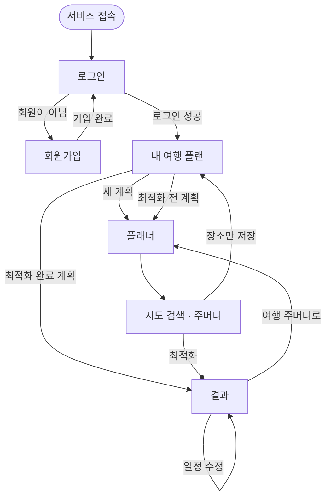

# 의쉬행 — 의외로 쉬운 여행

> 가고 싶은 장소만 담으면, 동선은 의쉬행이 정리합니다.

PC와 모바일(768px)에서 쓰는 여행 플래너 웹앱입니다. 나라·지역을 고르고 관광지·맛집·숙소를 주머니에 담은 뒤, 기간·출발일·숙소·도착/복귀를 넣으면 AI가 일차별 일정을 만듭니다.

- 배포: [https://for-all-cdd08.web.app](https://for-all-cdd08.web.app)

---

## 사용 흐름

1. 이메일로 가입한 뒤 로그인합니다. (가입 직후에는 로그인 화면으로 돌아갑니다.)
2. **내 여행 플랜**에서 새 계획을 만들거나, 저장한 계획을 이어갑니다.
3. 나라·지역을 고르고 Google 지도에서 장소를 검색해 **여행 주머니**에 담습니다.
4. 기간, 출발일, 숙소, 첫날 도착, 마지막날 복귀를 채운 뒤 **최적의 여행 계획 만들기**를 누릅니다.
5. 결과 화면에서 일차별 동선과 일정을 확인하고, 필요하면 수정한 뒤 저장합니다.

장소만 담아 두고 나중에 기간을 정해도 됩니다. (**장소만 저장하기**)



---

## 현재 기능

### 계정

- [x] 이메일·비밀번호 가입 / 로그인 / 로그아웃
- [x] 비밀번호 재설정 메일
- [x] 브라우저를 다시 열면 Firebase Auth 세션으로 로그인 유지
- [x] 이용약관 · 개인정보 처리방침

### 플랜

- [x] 내 여행 플랜 목록 (최근 수정순, 지역 썸네일)
- [x] 새 계획 만들기 · 이어서 편집 · 삭제
- [x] 나라·지역 선택 후 해당 지역 지도로 시작

### 플래너 (주머니)

- [x] Google Maps 장소 검색, 상세, 주머니에 담기
- [x] 장소를 숙소 / 관광지 / 맛집으로 분류
- [x] 여행 기간 (당일치기 ~ N박), 출발일
- [x] 숙소 지정
- [x] 첫날 도착 · 마지막날 복귀 (비행기 / 기차 / 자가용, 시각)
- [x] 하루 활동 시간, 아침·점심·저녁 포함 여부
- [x] 필수 값이 없으면 최적화를 막음
- [x] 관광지·맛집이 부족하면 경고 후 진행 가능
- [x] 장소만 저장하기

### AI 일정 · 결과

- [x] 휴무일, 영업시간, 브레이크 타임, 이동 거리를 반영한 일차별 일정
- [x] 결과 지도에 일차 동선 표시 (직선 동선, 길찾기 경로 아님)
- [x] 일정 수정 · 계획 저장
- [x] 최적화 완료 플랜은 목록에서 결과로 바로 진입

### 아직 없는 것

- 특정 장소를 지정 일차·시간대에 고정
- 날씨·우천 기준 실내 우선 배치
- 인기 장소 자동 추천, 무계획 코스 추천
- 장거리 이동 분선 가이드

---

## 화면

| 플래너 (장소 탐색) | 결과 (동선 확인) |
| :----------------: | :--------------: |
|  |  |

디자인: [Figma](https://www.figma.com/design/Tr34nleQ0fN0o2VThwd68F/%EC%9D%98%EC%99%B8%EB%A1%9C-%EC%89%AC%EC%9A%B4-%EC%97%AC%ED%96%89?m=auto&t=q17Uf3ew0zVRPNaM-6)

---

## 기술 스택

| 구분 | 사용 |
| --- | --- |
| 앱 | React 19, TypeScript, Vite, React Router |
| 지도 | Google Maps JavaScript API (`@vis.gl/react-google-maps`) |
| 인증·데이터 | Firebase Authentication, Cloud Firestore |
| AI | OpenAI Chat Completions. 배포는 Vercel `/api/openai-chat` 프록시, 로컬·Blaze는 Cloud Functions `openaiChat`도 사용 |
| 품질 | ESLint, Prettier |
| 배포 | Firebase Hosting (`dist` SPA), Vercel (최적화 프록시) |

---

## 로컬 실행

```bash
npm install
npm run dev
```

프로젝트 루트에 `.env`를 두고 Vite 변수를 넣습니다. `.env`는 git에 올리지 않습니다.

| 변수 | 용도 |
| --- | --- |
| `VITE_FIREBASE_API_KEY` | Firebase 웹 앱 키 |
| `VITE_FIREBASE_AUTH_DOMAIN` | Auth 도메인 |
| `VITE_FIREBASE_PROJECT_ID` | 프로젝트 ID |
| `VITE_FIREBASE_STORAGE_BUCKET` | Storage |
| `VITE_FIREBASE_MESSAGING_SENDER_ID` | 메시징 |
| `VITE_FIREBASE_APP_ID` | 앱 ID |
| `VITE_FIREBASE_MEASUREMENT_ID` | Analytics (선택) |
| `VITE_GOOGLE_MAPS_API_KEY` | Maps · Places 검색 |
| `VITE_OPENAI_PROXY_URL` | 예: `https://1-for-all.vercel.app` — 있으면 최적화가 이 프록시를 탐 |

그 외 스크립트: `npm run build`, `npm run lint`, `npm run format`

로컬에서 Functions로 OpenAI를 쓰려면 Firebase 프로젝트에 `openaiChat`과 OpenAI 시크릿이 있어야 하고, Spark 플랜은 외부 OpenAI 호출이 막힙니다. 배포 사이트는 `VITE_OPENAI_PROXY_URL`을 넣어 빌드하면 Spark여도 최적화가 됩니다.

---

## 배포

1. `npm run build` 후 Firebase Hosting에 `dist`를 올립니다. 프로덕션 최적화를 쓰려면 빌드 전에 `VITE_OPENAI_PROXY_URL`이 있어야 번들에 들어갑니다.
2. Vercel 프로젝트는 레포 루트의 `api/openai-chat.js`를 배포합니다. Production 환경 변수:
   - `OPENAI_API_KEY`
   - `FIREBASE_SERVICE_ACCOUNT` (서비스 계정 JSON 한 줄, `project_id` 포함)
3. Google Cloud API 키 웹사이트 제한에 Hosting 주소와 로컬 주소를 넣습니다. Firebase 웹 키와 Maps 키 **둘 다** 저장해야 로그인과 지도가 됩니다.

   `https://for-all-cdd08.web.app`, `https://for-all-cdd08.web.app/`, `https://for-all-cdd08.web.app/*`  
   (firebaseapp.com 동일, `http://localhost:5173` 동일)

브라우저 키·서비스 계정 JSON·OpenAI 키는 README나 git에 넣지 않습니다.

---

## Git · 커밋

- `main`: 시연 가능한 배포 브랜치
- `feature/...`: 기능 작업 후 PR로 `main`에 머지

커밋 메시지는 Conventional Commits, **본문은 영어**입니다.

| Prefix | 용도 |
| --- | --- |
| `feat` | 새 기능 |
| `fix` | 버그 수정 |
| `docs` | 문서 |
| `refactor` | 동작은 같고 구조만 정리 |
| `chore` | 도구·설정 |
| `perf` | 성능 |

---

## 팀

- Hwang Gilyong ([@kickboardboy-coder](https://github.com/kickboardboy-coder)) — 기획 / 프론트엔드
